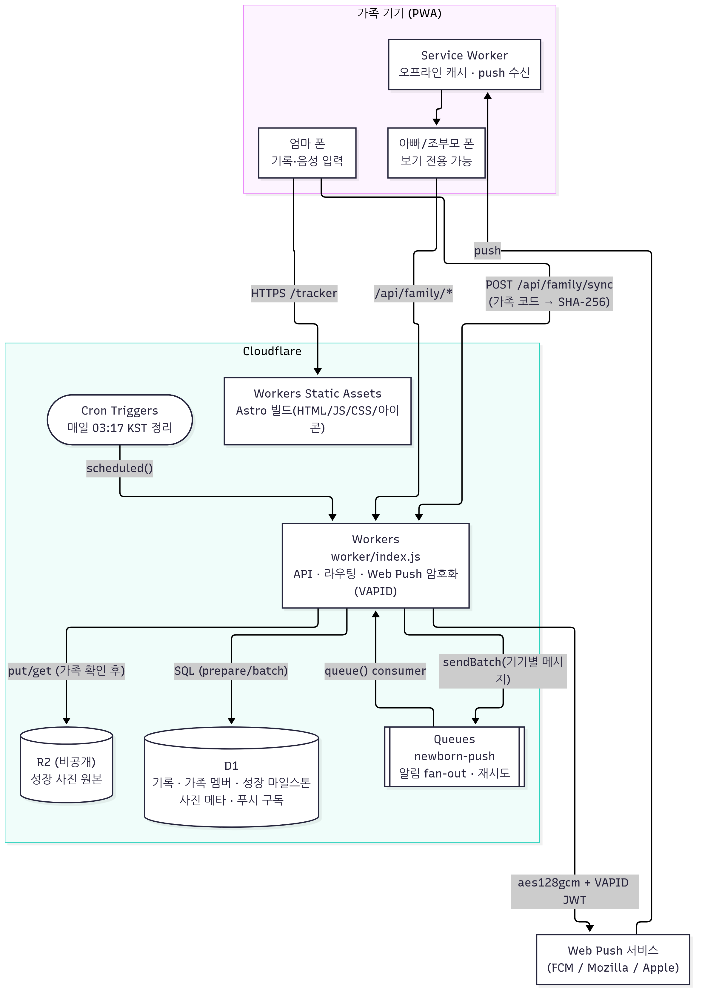
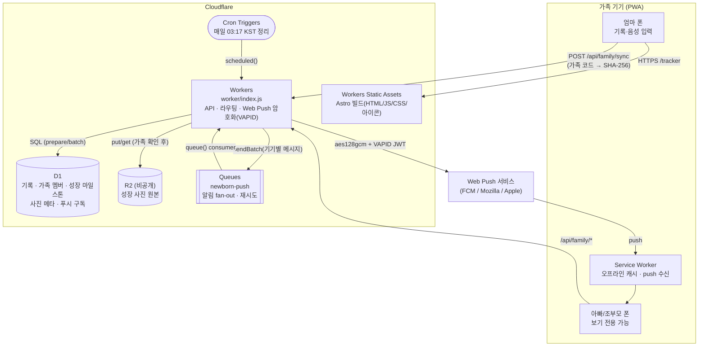

# 우리 아기 기록 (newborn tracker) — Cloudflare Workers로 만든 가족 공유 육아 기록 앱

> **Cloudflare Developer Day Seoul 2026 · Use Case 공모 출품작**
> 라이브: https://newbornkr.online/tracker · 개발자: 조규민 (개인 참가)

신생아를 키우는 가족이 **수유·기저귀·수면**을 한 손으로, 혹은 **말로** 기록하고, 엄마·아빠·조부모가 **가족 코드 하나로 같은 기록을 실시간으로 공유**하는 모바일 웹앱(PWA)입니다. 가입·로그인이 없고, 서버에는 가족 코드 원문이 저장되지 않습니다.

## English summary
A no-signup, installable baby log (feeds, diapers, sleep) for Korean families. One parent logs by tap or by voice (Korean / English / Portuguese parser), and every family member's phone stays in sync through a shared family code. The whole backend is a single **Cloudflare Worker**: static UI from **Workers Static Assets**, records and family data in **D1**, growth photos in a private **R2** bucket, Web Push (RFC 8291/8292, implemented with WebCrypto — no push SDK) fanned out through **Queues**, and daily housekeeping on **Cron Triggers**. The tracker was first built on 2026-10-29.

---

## 주요 기능
| 기능 | 설명 |
|---|---|
| ⚡ 원탭 기록 | 수유(모유/분유 ml), 기저귀(소변/대변), 수면 시작·종료. 마지막 기록부터 경과 시간 표시 |
| 🎤 음성 기록 | "분유 120 먹었어", "10분 전에 기저귀 갈았어" 같은 한국어 문장을 파싱(한자어 숫자·상대 시간 지원). 영어·포르투갈어(pt-BR)도 지원. 휴대폰 단축어(`?shortcut=voice`)로 바로 열기 |
| 🔮 다음 1시간 예측 | 최근 7일 패턴으로 다음 수유·기저귀 시점을 중앙값 기반으로 예측 |
| 📊 하루 타임라인 · 날짜 비교 | 24시간 타임라인, 시간대별 누적, 두 날짜 나란히 비교 |
| 👨‍👩‍👧 가족 공유 | 가족 코드/QR로 참여. 기록은 오프라인에서도 쌓이고(outbox) 연결되면 last-write-wins로 병합 |
| 👀 보기 전용 링크 | 조부모 등은 읽기·알림만 가능한 보기 전용 코드로 초대 (쓰기 요청은 서버에서 403) |
| 🔄 기록 옮기기 | 브라우저 ↔ 설치 앱 사이 일회용 이동 코드 (가족 코드는 이동 코드에서 파생한 키로 암호화해 보관) |
| 🔔 푸시 알림 | 가족이 기록·사진을 추가하면 다른 가족 기기에 알림 (보낸 기기 제외, 가족·종류별 2분 스로틀) |
| 🌱 성장 캘린더 | 생일 기준 국가예방접종·영유아검진·부모급여 일정, CDC 발달 이정표, 직접 쓰는 기념일, 성장 사진(R2) |
| 📲 PWA | 홈 화면 설치, Service Worker 오프라인 캐시, 한국어/English/Português |

## 왜 Cloudflare인가
- **Workers 하나로 끝나는 백엔드**: UI, API, 푸시 암호화, 큐 소비자, 크론까지 한 Worker(`worker/index.js`)에 있습니다. 서버 관리·콜드스타트 걱정 없이 새벽 3시 수유 기록도 즉시 응답합니다.
- **D1**: 가족 단위로 쪼개진 작은 관계형 데이터(기록, 멤버, 마일스톤, 푸시 구독)에 딱 맞고, `batch()` 트랜잭션으로 기록 순번(seq)을 안전하게 증가시킵니다.
- **R2 (비공개 버킷)**: 아기 사진은 공개 URL 없이 Worker가 가족 코드를 확인한 뒤에만 읽고 씁니다.
- **Queues**: 기록 저장 응답은 바로 돌려주고, 기기별 푸시 발송·재시도(429/5xx)는 큐 소비자가 처리합니다.
- **Cron Triggers**: 만료된 이동 코드와 오래된 스로틀 행을 매일 정리합니다.
- **무료 플랜**으로 운영 가능: 개인 가족 서비스에 맞는 비용 구조.

## 아키텍처




| Cloudflare 제품 | 역할 | 코드 |
|---|---|---|
| **Workers** | 모든 요청의 진입점. `/api/family/*` 가족 공유 API(생성·참여·동기화·보기 전용·이동 코드·사진·푸시 구독), 동일 출처 검사, IP별 rate limit, Web Push 페이로드 암호화(RFC 8291 aes128gcm)와 VAPID 서명(RFC 8292, ES256) — 모두 WebCrypto로 직접 구현 | `worker/index.js`, `worker/family-api.js`, `worker/web-push.js` |
| **Workers Static Assets** | Astro로 빌드한 정적 UI·Service Worker·PWA 매니페스트/아이콘 제공, `_redirects`, 404 페이지 | `wrangler.jsonc` `assets`, `public/`, `src/` |
| **D1** (`DB`) | `families`, `entries`(기록, seq 기반 증분 동기화·tombstone), `members`, `handoffs`(이동 코드, 암호화 보관), `profiles`, `milestone_marks`, `custom_milestones`, `photos`(메타), `push_subs`, `push_throttle`, `view_codes`, `view_members` | `migrations/0001_init.sql` |
| **R2** (`PHOTOS`, 비공개) | 성장 사진 바이트 저장. 공개 URL 없음, Worker가 가족 확인 후 프록시 | `worker/family-api.js` (`photo-put`/`photo-get`) |
| **Queues** (`PUSH_QUEUE`) | 기록/사진 추가 시 대상 기기마다 메시지 1개 → `queue()` 소비자가 푸시 발송, 404/410이면 구독 삭제, 429/5xx면 재시도 | `famNotify`, `famDeliverPush` |
| **Cron Triggers** | 매일 만료된 이동 코드·오래된 스로틀 정리 | `scheduled()`, `famCleanup` |

### 개인정보 설계
- 가족 코드는 서버에 **SHA-256 해시로만** 저장 (`family_id`). 이동 코드로 넘기는 가족 코드는 이동 코드에서 파생한 키로 AES-GCM 암호화.
- 가족 코드가 없으면 기록은 **기기 localStorage에만** 있고 서버로 나가지 않습니다.
- 푸시 알림 본문에는 종류와 시각만 들어가고 ml 같은 상세 값은 넣지 않습니다.
- 분석 도구(GA4, Cloudflare Web Analytics)는 선택 사항이며, 켜더라도 URL의 가족/이동 코드는 제거한 뒤 전송합니다.

## 로컬에서 실행하기
필요: Node.js 20+ (테스트는 24에서 확인), npm.

```bash
npm install
cp .dev.vars.example .dev.vars
node scripts/gen-vapid.mjs > .dev.vars        # 로컬 전용 VAPID 키 생성 (커밋 금지)
npx wrangler d1 migrations apply DB --local   # 로컬 D1(Miniflare)에 스키마 적용
npm run dev                                   # astro build && wrangler dev → http://localhost:8787/tracker
```
- 로컬 개발은 D1·R2·Queues 모두 Miniflare 로컬 에뮬레이션을 쓰므로 Cloudflare 계정이 필요 없습니다.
- 크론 테스트: `npx wrangler dev --test-scheduled` 후 `curl http://localhost:8787/cdn-cgi/handler/scheduled`
- 단위 테스트(191개): `npm test`
- 큐 푸시 E2E(로컬 wrangler dev 실행 중): `BASE=http://localhost:8787 node tests/queue-push.e2e.mjs`

### 환경 변수
| 이름 | 종류 | 설명 |
|---|---|---|
| `VAPID_PUBLIC_KEY` | secret / `.dev.vars` | Web Push 공개키 (base64url) |
| `VAPID_PRIVATE_KEY` | **secret** / `.dev.vars` | Web Push 개인키 — 절대 커밋하지 마세요 |
| `VAPID_SUBJECT` | var | `mailto:` 연락처 |
| `PUBLIC_GA_ID` | 빌드 시 (선택) | GA4 측정 ID. 비우면 비활성 |
| `PUBLIC_CF_BEACON_TOKEN` | 빌드 시 (선택) | Cloudflare Web Analytics 토큰. 비우면 비활성 |

## 배포하기
```bash
npx wrangler login
npx wrangler d1 create newborn-family          # 출력된 database_id를 wrangler.jsonc에 입력
npx wrangler r2 bucket create newborn-photos   # 공개 액세스는 켜지 않음
npx wrangler queues create newborn-push
npx wrangler d1 migrations apply DB --remote
node scripts/gen-vapid.mjs                     # 운영용 키를 새로 만들고 아래 두 값을 secret으로 등록
npx wrangler secret put VAPID_PUBLIC_KEY
npx wrangler secret put VAPID_PRIVATE_KEY
npm run deploy                                 # astro build && wrangler deploy
```

## 폴더 구조
```
worker/       Worker 진입점(fetch/queue/scheduled), 가족 API, Web Push
migrations/   D1 스키마
src/          Astro 페이지·뷰(트래커, 성장 캘린더, 앱 설치)와 클라이언트 로직(src/lib)
public/       Service Worker(sw.js, tracker-sw.js), 아이콘, _redirects
tests/        단위 테스트(node:test) + 로컬 큐 E2E
docs/         아키텍처 다이어그램, 성장 캘린더 데이터 출처
```

## 오픈소스 · 외부 코드 및 데이터 출처 (Credits)
| 항목 | 용도 | 라이선스 |
|---|---|---|
| [Astro](https://astro.build) | 정적 사이트 빌드 | MIT |
| [qrcode-generator](https://github.com/kazuhikoarase/qrcode-generator) (Kazuhiko Arase) | 가족 초대 QR 코드 | MIT |
| [Wrangler](https://github.com/cloudflare/workers-sdk) / Miniflare | 로컬 개발·배포 (devDependency) | MIT OR Apache-2.0 |
| [Feather Icons](https://feathericons.com) | UI 아이콘 (SVG 경로를 `src/lib/icons.ts`에 포함) | MIT |
| Web Push 암호화 | RFC 8291 / RFC 8292 명세를 보고 WebCrypto로 직접 구현 (외부 라이브러리 미사용) | — |
| 질병관리청 표준예방접종일정표, 국민건강보험공단 영유아검진, 복지로 | 성장 캘린더 일정 데이터 | 공공 정보 (출처: `docs/growth-sources.md`) |
| U.S. CDC "Learn the Signs. Act Early." | 발달 이정표 (한국어는 자체 번역) | 공공 정보 (출처: `docs/growth-sources.md`) |
| `src/data/` 지역별 육아지원금 데이터 | 같은 개발자가 운영하는 newbornkr.online 지원금 안내 데이터(공식 공고 기반) | 자체 |

폰트는 기기 기본 시스템 폰트를 사용하며 외부 웹폰트는 쓰지 않습니다.

## 개발 타임라인
- ~2026-10: 지역별 육아지원금 안내 사이트(newbornkr.online) 운영 — **본 출품작 아님**
- 2026-10-29: 아기 기록 트래커 첫 버전 (로컬 저장)
- 2026-11: 가족 공유(D1), 음성 기록, 성장 캘린더·사진(R2), 푸시 알림, 보기 전용 링크, 다음 1시간 예측
- 2026-11 (공모 준비): 단독 Worker + Static Assets로 전환, Queues 푸시 fan-out, Cron Triggers 정리 작업 추가
